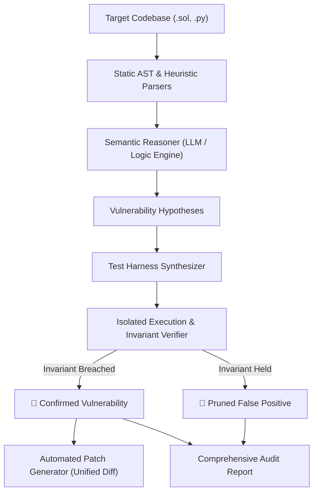

# 🛡️ AuditAgent: Self-Auditing & Compliance Security Agent

> **Autonomous open-source security agent combining AST static analysis, LLM semantic reasoning, and empirical Proof-of-Concept (PoC) verification for Smart Contracts and Web Applications.**

Traditional SAST/DAST tools overwhelm developers with false positives because they flag structural patterns without understanding context. Manual audits, while thorough, cost tens of thousands of dollars.

**AuditAgent solves this by adopting an empirical verification loop**: before any vulnerability is reported, the agent synthesizes an isolated test harness (Foundry/Pytest/Simulated EVM) and runs it against the code. 
- If the invariant breach is **proven** $\rightarrow$ the vulnerability is confirmed with an execution trace and a ready-to-use patch.
- If the invariant **holds** $\rightarrow$ it is automatically pruned as a false positive.

---

## 🚀 Key Features

- **Multi-Target Analysis**: Native support for **Solidity Smart Contracts** (Reentrancy, Access Control, Checks-Effects) and **Web Application APIs** (IDOR, Broken Authentication).
- **Hybrid Semantic Reasoning**: Combines lightweight AST parsing with deep reasoning to formulate testable vulnerability hypotheses.
- **Automated Verification Harness Synthesis**: Automatically drafts isolated test scripts (Foundry `.t.sol`, Pytest) targeted at proving the invariant breach.
- **Empirical Execution & Invariant Checking**: Runs tests in an isolated sandbox or state simulator to empirically confirm exploits before alerting developers.
- **False-Positive Elimination**: Drastically reduces alert fatigue by discarding unconfirmed theoretical warnings.
- **Automated Remediation**: Generates git-compatible unified diff (`patch`) fixes for confirmed bugs.
- **Auditing Reports**: Exports actionable, structured audit reports in Markdown and JSON.

---

## 🏗️ Architecture



---

## ⚡ Quickstart

### Prerequisites
- Python >= 3.12 (managed automatically via [uv](https://docs.astral.sh/uv/))

### Installation
Clone the repository and install dependencies:
```bash
git clone <repo-url>
cd audit-agent
uv sync
```

### Run Live Demonstration
Test the engine against a smart contract containing real reentrancy, authorization bypass, and safe withdrawal patterns:
```bash
uv run audit-agent demo
```

### Scan a Target File
To audit a Solidity contract:
```bash
uv run audit-agent scan examples/VulnerableVault.sol --output audit_report.md
```

To audit a Web App API:
```bash
uv run audit-agent scan examples/vulnerable_api.py --output api_report.md
```

---

## 🧪 Running Tests
```bash
uv run pytest
```

---

## 📂 Project Structure
```text
audit-agent/
├── examples/
│   ├── VulnerableVault.sol      # Example smart contract with real & benign patterns
│   └── vulnerable_api.py        # Example FastAPI app with IDOR vulnerability
├── src/
│   └── audit_agent/
│       ├── cli.py               # Rich terminal CLI
│       ├── models.py            # Pydantic schemas (Hypotheses, Findings, Reports)
│       ├── orchestrator.py      # End-to-end scanning & verification pipeline
│       ├── parsers/             # AST & code heuristics (Solidity, Web APIs)
│       ├── reasoner/            # Semantic reasoning & test synthesis prompts
│       ├── remediation/         # Automated patch generator (unified diffs)
│       └── verifiers/           # Foundry, EVM Invariant Simulator, and API runners
├── tests/
│   └── test_audit_agent.py      # Integration and unit test suite
├── pyproject.toml
└── README.md
```

---

## 👤 Author
- **Franca Roscilli**
- GitHub: [@francaroscillidev-gif](https://github.com/francaroscillidev-gif)
- Email: [francaroscillidev@gmail.com](mailto:francaroscillidev@gmail.com)

## 📜 License
Licensed under the Apache License, Version 2.0. See [LICENSE](LICENSE) for details.
Copyright 2026 Franca Roscilli.

