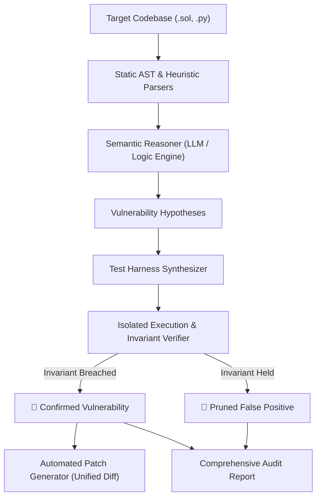

<p align="center">
  
</p>

<h1 align="center">🛡️ AuditAgent</h1>
<p align="center">
  <strong>Autonomous Enterprise Security & Compliance Agent with Empirical Proof-of-Concept Verification</strong><br>
  <em>For Web3 Smart Contracts (Solidity/Foundry) and Web Application APIs</em>
</p>

<p align="center">
  <a href="https://github.com/francaroscillidev-gif/audit-agent/actions"></a>
  <a href="LICENSE"></a>
  <a href="https://github.com/francaroscillidev-gif/audit-agent/releases"></a>
  <a href="https://swcregistry.io"></a>
  <a href="https://cwe.mitre.org"></a>
</p>

---

Traditional SAST/DAST tools overwhelm developers with false positives because they flag structural patterns without understanding context. Manual audits, while thorough, cost tens of thousands of dollars.

**AuditAgent solves this by adopting an empirical verification loop**: before any vulnerability is reported, the agent synthesizes an isolated test harness (Foundry/Pytest/Simulated EVM) and runs it against the code. 
- If the invariant breach is **proven** $\rightarrow$ the vulnerability is confirmed with an execution trace and a ready-to-use patch.
- If the invariant **holds** $\rightarrow$ it is automatically pruned as a false positive.

---

## 🚀 Key Features

- **Multi-Target Analysis**: Native support for **Solidity Smart Contracts** (Reentrancy, Access Control, Checks-Effects) and **Web Application APIs** (IDOR, Broken Authentication).
- **Hybrid Semantic Reasoning**: Combines lightweight AST parsing with deep reasoning to formulate testable vulnerability hypotheses.
- **Automated Verification Harness Synthesis**: Automatically drafts isolated test scripts (Foundry `.t.sol`, Pytest) targeted at proving the invariant breach.
- **Empirical Execution & Invariant Checking**: Runs tests in an isolated sandbox or state simulator to empirically confirm exploits before alerting developers.
- **False-Positive Elimination**: Drastically reduces alert fatigue by discarding unconfirmed theoretical warnings.
- **Deep Code & Security Inspector**: Visualizes Control Flow Graphs (CFG), Basic Blocks, Data-Flow Taint tracking from sources to sensitive sinks, and Multi-Contract Call Graphs (`audit-agent inspect <target>`).
- **CVSS v3.1 Threat & Financial Exposure Scoring**: Computes standard CVSS vectors, severity base scores (0.0 - 10.0), and estimated Protocol Financial Value at Risk (TVL exposure).
- **Interactive Validated Patch Applier**: Automatically applies the verified security fix to source files and runs immediate re-verification (`audit-agent fix <target>`).
- **Exploit-to-Test Transpiler**: Exports verified exploits as permanent regression test files (`test/Audit_HYP_001.t.sol` or `pytest`) so bugs can never recur (`audit-agent export-tests <target>`).
- **Continuous Watch Daemon**: Real-time auditing background daemon that instantly re-audits code on file save (`audit-agent watch <target>`).
- **Multi-Model LLM Adapter**: Out-of-the-box support for Google Gemini, OpenAI, Anthropic, local Ollama (Llama 3 / DeepSeek-Coder), and offline expert engine (`--provider gemini|openai|anthropic|ollama|offline_expert`).
- **Stateful Invariant Fuzzing**: Runs property-based transaction sequences to discover non-trivial state corruption (solvency breaches, privilege escalation).
- **OASIS SARIF v2.1.0 Export**: Full compatibility with GitHub Code Scanning alerts, VS Code, and SonarQube (`--sarif results.sarif`).
- **Compliance Taxonomy Matrix**: Direct cross-referencing to Web3 **SWC Registry** (e.g., SWC-107, SWC-105) and universal **CWE / OWASP Top 10** standards.
- **Interactive Dark-Themed HTML Dashboard**: Self-contained visual dashboard with interactive filters, trace viewer, and colorized diffs.
- **Automated Remediation**: Generates git-compatible unified diff (`patch`) fixes for confirmed bugs.
- **Self-Healing Harness Loop**: Automatically intercepts compiler errors and repairs test harnesses.

---

## 🏗️ Architecture



---

## ⚡ Quickstart

### Prerequisites
- Python >= 3.12 (managed automatically via [uv](https://docs.astral.sh/uv/))

### Installation
Clone the repository and install dependencies:
```bash
git clone <repo-url>
cd audit-agent
uv sync
```

### Run Live Demonstration
Test the engine against a smart contract containing real reentrancy, authorization bypass, and safe withdrawal patterns:
```bash
uv run audit-agent demo
```

### Scan a Target File or Directory
To audit with Markdown, HTML Dashboard, and GitHub Code Scanning SARIF:
```bash
uv run audit-agent scan examples/ --output audit_report.md --html dashboard.html --sarif results.sarif
```

### Deep Code Inspection (CFG, Taint Analysis, Call Graph, CVSS)
Analyze control flow graphs, unconstrained data-flow taint paths, and financial threat tiers:
```bash
uv run audit-agent inspect examples/VulnerableVault.sol
```

### Automatically Apply Verified Patches
Apply the security fix directly to the target file with rollback protection and instant re-verification:
```bash
# Preview what changes would be made
uv run audit-agent fix examples/VulnerableVault.sol --dry-run

# Apply and confirm invariant holding
uv run audit-agent fix examples/VulnerableVault.sol
```

### Export Verified Exploits as Permanent Regression Tests
Transpile confirmed invariant breaches into ready-to-commit Foundry or Pytest test suites:
```bash
uv run audit-agent export-tests examples/VulnerableVault.sol --outdir tests/security
```

### Continuous Watch Mode
Monitor files for modifications and re-audit on save:
```bash
uv run audit-agent watch examples/
```

### Property-Based Invariant Fuzzing
Stress-test contract state across 100 randomized transaction sequences:
```bash
uv run audit-agent fuzz examples/VulnerableVault.sol --runs 100
```

### View Compliance Standards Matrix
Display mappings between vulnerability categories, SWC, CWE, and OWASP:
```bash
uv run audit-agent compliance
```

### Initialize GitHub Actions CI/CD
Generate `.github/workflows/security-audit.yml` to automatically audit pull requests:
```bash
uv run audit-agent init-ci
```

---

## 🧪 Running Tests
```bash
uv run pytest
```

---

## 📂 Project Structure
```text
audit-agent/
├── examples/
│   ├── VulnerableVault.sol      # Example smart contract with real & benign patterns
│   └── vulnerable_api.py        # Example FastAPI app with IDOR vulnerability
├── src/
│   └── audit_agent/
│       ├── cli.py               # Rich terminal CLI
│       ├── models.py            # Pydantic schemas (Hypotheses, Findings, Reports)
│       ├── orchestrator.py      # End-to-end scanning & verification pipeline
│       ├── parsers/             # AST & code heuristics (Solidity, Web APIs)
│       ├── reasoner/            # Semantic reasoning & test synthesis prompts
│       ├── remediation/         # Automated patch generator (unified diffs)
│       └── verifiers/           # Foundry, EVM Invariant Simulator, and API runners
├── tests/
│   └── test_audit_agent.py      # Integration and unit test suite
├── pyproject.toml
└── README.md
```

---

## 📬 Contact, Support & Commercial Inquiries

If you have questions, feedback, enterprise integration requests, or custom agent governance needs, feel free to reach out directly:

- **Lead Developer & Maintainer:** Franca Roscilli
- **Email:** [francaroscillidev@gmail.com](mailto:francaroscillidev@gmail.com)
- **GitHub:** [@francaroscillidev-gif](https://github.com/francaroscillidev-gif)
- **Bug Reports & Feature Requests:** [Open an issue on GitHub](https://github.com/francaroscillidev-gif/audit-agent/issues)

## 📜 License
Licensed under the Apache License, Version 2.0. See [LICENSE](LICENSE) for details.
Copyright 2026 Franca Roscilli.

